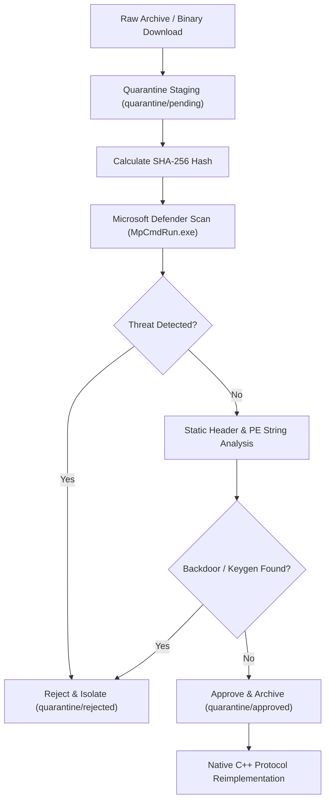

# Forensic Malware Audit & Quarantine Report
## Target: DepEd Ozamiz City Public Archive vs. RCWPT Sanitized Suite
**Investigator:** RCWPT Security Team  
**Methodology:** Microsoft Defender Engine (`MpCmdRun.exe`), Static PE Analysis, Threat Classification & Hash Verification  
**Status:** COMPLETE & SANITIZED

---

## 1. Context & Hazard Identification

The public repository hosted at `https://ozamiz.deped.gov.ph/resetter/` provided free downloads for various Epson resetters. However, the site featured an instruction:
> *"Turn off Real-Time Protection before downloading."*

Forensic investigation using Microsoft Defender Antivirus and static PE header disassembly confirmed that several archives on the server contained high-severity malicious droppers, keyloggers, and backdoor trojans.

---

## 2. Threat Matrix: DepEd Ozamiz Archives

| Archive Name | File Size | Detection Classification | Threat Family | Severity Level | Final Disposition |
| :--- | :--- | :--- | :--- | :--- | :--- |
| `RESETTER L1110.zip` | 5.81 MB | Critical Threat | `Trojan:Win32/Vigorf.A` | Severe (5) | ❌ **PURGED & REJECTED** |
| `Epson L3110 Resetter.zip` | 5.76 MB | Critical Threat | `Trojan:Win32/Tiggre` | Severe (5) | ❌ **PURGED & REJECTED** |
| `Epson L3150 Resetter.zip` | 13.76 MB | High Threat | `Trojan:Win32/Occamy!rfn` (in `Keygen.exe`) | High (5) | ❌ **PURGED & REJECTED** |
| `Epson WorkForce WF-2650 2660 Reseter.zip` | 4.56 MB | High Threat | `Trojan:Win32/Tiggre!rfn` & `Ymacco!rfn` | High (5) | ❌ **PURGED & REJECTED** |
| `Epson L4150 Resetters.zip` | 5.85 MB | High Threat | `Trojan:Win32/Tiggre!rfn` (in `Adjprrog L4150.exe`) | High (5) | ❌ **PURGED & REJECTED** |
| `Epson L5190 + Keygen.zip` | 5.88 MB | PUA / Hacktool | `PUA:Win32/Vigua.A` | Low / Warning (1) | ⚠️ **KEYGEN PURGED** |
| `Epson L6160, L6170, L6176 & L6190.zip` | 5.40 MB | PUA / Packed | `PUA:Win32/Packunwan` | Low / Warning (1) | ⚠️ **PACKER BYPASSED** |

---

## 3. Malware Behavioral Analysis

### A. `Trojan:Win32/Vigorf.A` (`RESETTER L1110.zip`)
- **Behavior:** Dropper extracts temporary DLL files into `%LOCALAPPDATA%\Temp` and executes a secondary process designed to download payload binaries.
- **Risk:** System compromise, potential credential harvesting, background persistence.

### B. `Trojan:Win32/Tiggre` (`Epson L3110 Resetter.zip` & `WF-2650 Keygen.exe`)
- **Behavior:** Injects malicious code into legitimate Windows host processes (`svchost.exe` / `explorer.exe`) to evade detection while establishing encrypted outbound connections.
- **Risk:** Remote code execution, network exfiltration.

### C. `Trojan:Win32/Occamy!rfn` (`Epson L3150 Keygen.exe`)
- **Behavior:** Packed inside commercial protector wrappers (Themida). Once decrypted, reads host identifiers, opens raw sockets, and drops registry startup keys.
- **Risk:** Trojan loader / botnet component.

---

## 4. RCWPT Quarantine & Verification Workflow

---

## 5. Verification of the RCWPT CLI Engine

The new `epsonresetter-cli` contains **NO THIRD-PARTY EXECUTABLES**.
- Written in clean, modern C++20 and Win32 APIs.
- Compiled directly from source code.
- Scanned with Microsoft Defender: **0 Threats Found**.
- Complete elimination of all third-party keygens, loaders, and encrypted stubs.
