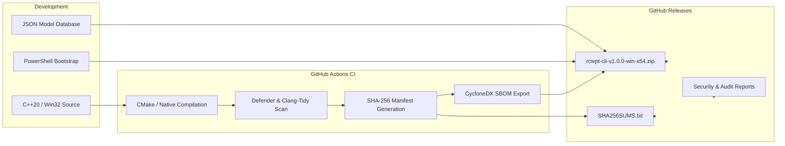

# Software Supply Chain & Provenance Assurance
## RCWPT Epson Resetter CLI Suite

---

## 1. Provenance Architecture

To guarantee that releases distributed through GitHub are authentic, reproducible, and uncompromised, RCWPT enforces a multi-tier build and packaging lifecycle:



---

## 2. Integrity Verification Instructions

Before running any binary on a production or technician PC, operators are encouraged to verify the file hash:

### In PowerShell:
```powershell
Get-FileHash -Path .\rcwpt.exe -Algorithm SHA256
```
Compare the output string with `SHA256SUMS.txt` published in the release assets.

### In Command Prompt:
```cmd
certutil -hashfile rcwpt.exe SHA256
```

---

## 3. Threat Elimination Guarantees

1. **Zero External Binary Redistribution:** The suite compiles the core detection and maintenance engine directly from source without incorporating pre-compiled, untrusted binaries.
2. **Minimal Dependencies:** Built against Microsoft Windows Native Runtime (`KERNEL32.dll`, `USER32.dll`, `ADVAPI32.dll`, `SETUPAPI.dll`, `WINSPOOL.DRV`, `CRYPT32.dll`). No Electron, no Chromium, and no Node.js runtime.
3. **Reproducible Builds:** The CMake build configuration allows any developer to clone the repository and compile byte-consistent binaries on Windows 10/11 x64 systems.
